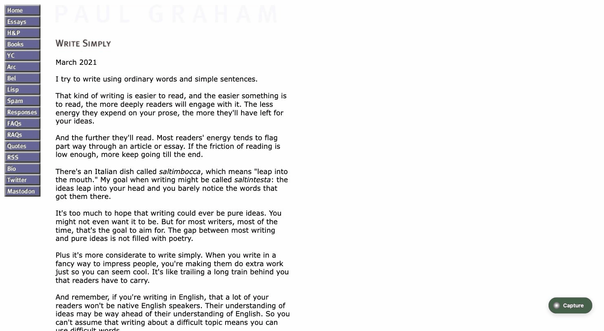
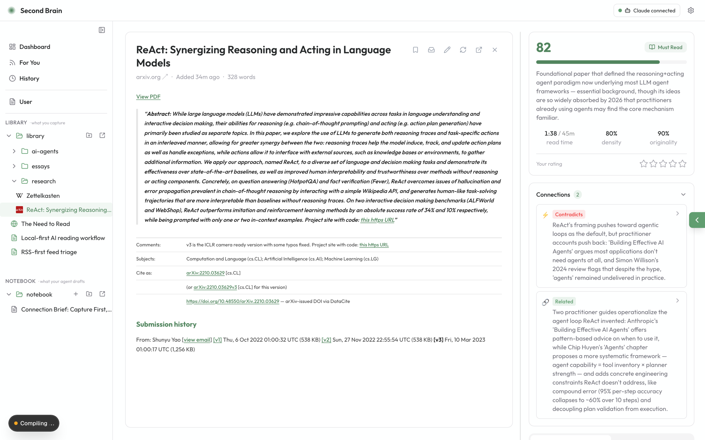
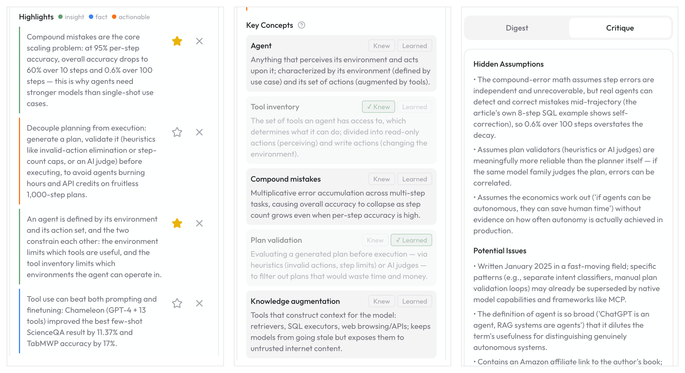
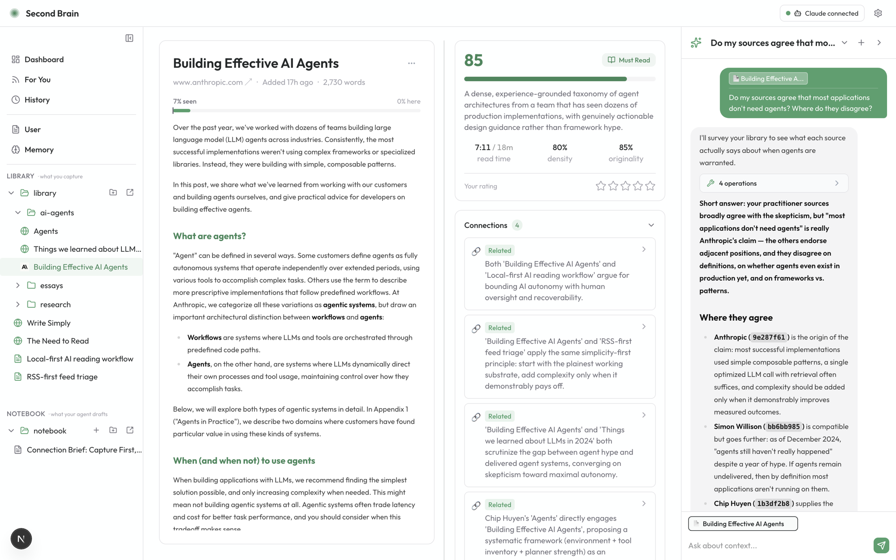
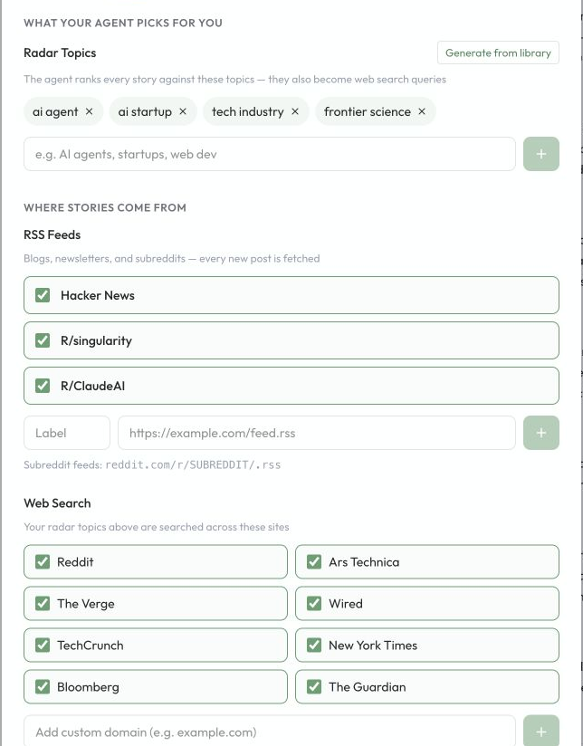
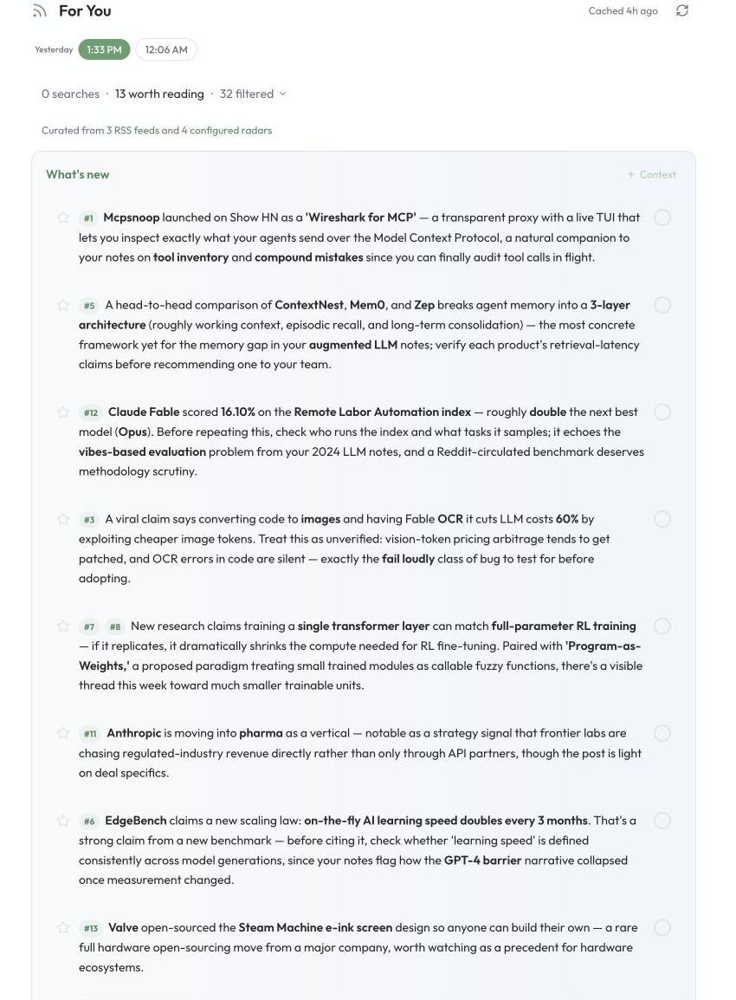

<div align="center">


# Second Brain

### You can't read everything. You don't have to.

[](LICENSE)
[](#get-started-in-2-minutes)
[](#your-data-stays-yours)
[](CONTRIBUTING.md)

**Information grows faster than any brain can follow. Second Brain is a local-first
workspace with an agent inside: it triages and critiques what you capture, finds
meaningful connections across your library, remembers what you know, and
proactively recommends sources you'd actually want.**

The reading — and the judgment — stay yours.

[Get started](#get-started-in-2-minutes) · [How it works](#how-it-works) · [Why local-first](#your-data-stays-yours) · [Chrome extension](#capture-anything-in-one-click)



</div>

---

## Your attention is a constant. Information isn't.

AI made content exponential. Your attention didn't move. Reading faster won't close that gap — **choosing better** will.

Every "save for later" tool works the wrong end: saving is easy, deciding is hard. Second Brain moves the decision to the front — **triage before you read** — so the piece that matters gets your full attention, and the forty that don't never cost you a minute.

## Don't outsource your understanding — or your judgment

Nobody needs one more tool that turns essays into three bullets so you can pretend you read them. **That is not what this is.**

Second Brain's AI does exactly two jobs — and reading for you isn't one of them:

1. **Filter** — score and critique every capture, so you can recognize AI slop and shallow takes before they cost you twenty minutes of your life.
2. **Deepen** — when something *is* worth reading, you read the original, with analysis beside the text: concepts explained, hidden assumptions flagged, contradictions with your other sources surfaced.

Every verdict is advisory. Every analysis is an editable file on your disk. The reader stays human — that's the point, not a limitation.

<div align="center">

<br/>
<em>The original stays front and center. The verdict, the critique, and a "this contradicts what you read last week" sit beside it.</em>
</div>

## What you get

### Runs on what's already yours

- **No new subscription** — analysis runs through the coding agent you already pay for ([Claude Code](https://docs.claude.com/en/docs/claude-code/setup) or [Codex CLI](https://github.com/openai/codex)). No model API keys, no metered bill.
- **All data on your disk** — every source is a folder of markdown and JSON. Grep it, git it, sync it, leave anytime. No database, no cloud, no lock-in.

### Capture fast, decide faster

- **Capture anything in seconds** — paste a link or text, drop a PDF or image, or one-click the Chrome extension (logged-in and JS-rendered pages included).
- **A triage card on every source** — score, read-time estimate, and a straight verdict: deep read, skim, or skip. Judge in five seconds whether something deserves fifty minutes.
- **Read with a critical companion** — when something is worth it, you read the original with digest and critique beside the text: concepts explained, hidden assumptions and shaky claims flagged. It sharpens your reading instead of replacing it.
- **A library that argues with itself** — new captures are checked against the most relevant sources in your library: what they support, repeat, or **contradict**.

<div align="center">

<br/>
<em>Beside every worthwhile read: the quotes worth keeping, the concepts worth learning (Knew / Learned), and a critique that keeps you honest.</em>
</div>

### Agentic to the core

- **Your library is the agent's workspace** — plain local files mean the agent reads and organizes the exact same files you see. Hand it content anytime: reorganize the library, or draft a post from what you've been reading lately, straight into your Notebook.
- **Information comes to you** — the "For You" feed ranks RSS (and optional search) against your interests and reading history. It breaks the bottleneck of only knowing what you went looking for. Works out of the box, no API key.
- **You control what it knows** — `USER.md` holds your explicit preferences; `MEMORY.md` is the agent's own evolving notes about you, visible and editable right in the app. Modern agent memory, without the black box.

<div align="center">

<br/>
<em>Ask across your library — the agent works the same files you see, and shows its work.</em>
</div>

### Tune the radar, and the feed follows

"For You" is not a generic news feed. Tune the radar topics, RSS feeds, and optional web search sources yourself; Second Brain ranks fresh stories against what you've already read, upvoted, and skipped. Start the morning with a briefing that speaks in terms of *your* library, not headlines.

<table>
  <tr>
    <td width="42%" align="center" valign="middle">
      <h4>1. Tune what it watches</h4>
      
      <br/><sub><b>User-tunable by design</b> — generate topics from the library, edit them by hand, or change the source mix any time.</sub>
    </td>
    <td width="58%" align="center" valign="top">
      <h4>2. Get a library-aware briefing</h4>
      
      <br/><sub><b>Start with the briefing</b> — fresh stories explained against your radar and what you've already read.</sub>
    </td>
  </tr>
</table>

## How it works

1. **Capture** — paste a link, drop a PDF, or one-click the Chrome extension on any page (even logged-in and JS-rendered ones).
2. **AI triages** — content is extracted, scored, summarized, critiqued, and connected to what you've already read.
3. **You read and judge** — the sources worth it get your real attention: original text front and center, analysis at your side. Everything the AI wrote is yours to edit — or overrule.

## Get started in 2 minutes

All you need is **Node 20+** and one agent CLI you already use, signed in:
[Claude Code](https://docs.claude.com/en/docs/claude-code/setup) (`claude`) or [OpenAI Codex](https://github.com/openai/codex) (`codex`).

```bash
git clone https://github.com/ryannli/secondbrain.git
cd secondbrain
npm install
npm run dev
```

Open [http://localhost:3000](http://localhost:3000), confirm your agent shows **Connected**, and hit **Enable Agent Mode**. First launch seeds a small example library so you can feel the product before capturing anything.

Want a guided path? See [docs/ONBOARDING.md](docs/ONBOARDING.md).

<a id="chrome-extension"></a>
## Capture anything in one click

The optional **Chrome extension** captures pages exactly as you see them — including logged-in pages, JS-heavy apps, and tweets. Bookmark a tweet on X and it lands in your library automatically (you can turn that off).

Load it from `chrome://extensions` → **Load unpacked** → select the `extension/` folder. A welcome page opens, checks the connection, and walks you through the rest.

No extension? Paste links, text, PDFs, and images straight into the dashboard.

## Your data stays yours

This is not a philosophy section — it's the architecture:

```text
library/{id}/
├── meta.json        # capture metadata — never modified
├── original.*       # the raw source — never modified
├── content.md       # readable content — yours to edit
├── analysis.json    # AI analysis — yours to edit, safe to regenerate
└── README.md        # human-readable triage card
```

- Everything lives in a folder you choose (`./user_data` by default, or `SECONDBRAIN_ROOT=~/SecondBrain npm run dev`).
- Originals are evidence and never overwritten; analysis is workspace and always regenerable.
- Content is analyzed through **your** authenticated local agent session — it never touches a third-party server of ours. There isn't one.

## Under the hood

<details>
<summary><b>Feed & search configuration</b></summary>

The For You feed works in RSS-only mode by default, seeded with high-signal feeds (Hacker News, r/singularity, r/LocalLLaMA, r/ClaudeAI). Add your own in **Settings → Feed**.

Optional: broaden coverage with a [Brave Search API key](https://brave.com/search/api/) (free tier available):

```bash
cp .env.example .env.local   # then paste your key into BRAVE_SEARCH_API_KEY
```

`.env.local` is git-ignored. Without a key, the feed still runs on RSS and says so clearly.

</details>

<details>
<summary><b>Agent providers & privacy boundary</b></summary>

Second Brain calls a local agent CLI via subprocess — Claude Code (`claude`) or OpenAI Codex (`codex`). Pick your provider in Agent Mode setup or Settings.

- Captured content is sent through your authenticated local agent session for analysis.
- No separate model API key is required for core analysis.
- Prompt/response debug logs are **off by default**. `SECONDBRAIN_AGENT_DEBUG_LOGS=1` enables them for local debugging only — they can contain source text.

Agent Mode is required: if no provider is connected, you get a setup gate instead of a degraded app.

</details>

<details>
<summary><b>Development</b></summary>

```bash
npm test
npm run lint
npm run build
```

Pipeline tracing: `SECONDBRAIN_DEBUG=1 npm run dev`.

Contributor guide: [CONTRIBUTING.md](CONTRIBUTING.md). Agent-facing project context lives in [AGENTS.md](AGENTS.md) (`CLAUDE.md` is a symlink so Claude Code and Codex share one context).

</details>

## Status

Early, local-first, and moving fast. The web app is the recommended entrypoint; extension store distribution and a desktop build are on the roadmap. If the problem resonates, star the repo and [open an issue](../../issues) — the roadmap is negotiable, the philosophy isn't.

## License

[MIT](LICENSE)
