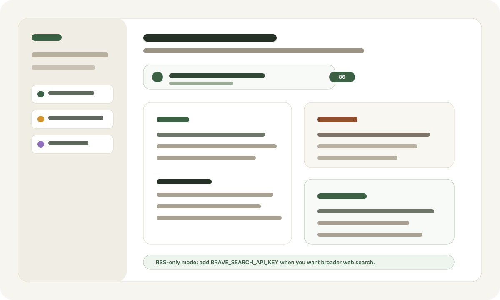

# Second Brain

**AI triage for people who read more than they can reasonably process.**

Second Brain turns links, notes, PDFs, images, and feeds into a local-first reading workspace. It preserves the original source, creates an editable analysis layer, and helps you decide what deserves real attention.



## Why It Exists

AI made it cheap to produce information. It did not make your attention bigger.

Second Brain is built around a sharper loop:

1. Capture anything quickly.
2. Let AI summarize, critique, and connect it.
3. Spend your judgment only where it matters.

This is not a passive bookmark manager. It is an attention filter with a filesystem you own.

## Key Features

| Feature | What it does |
| --- | --- |
| Triage cards | Scores each source and recommends whether to read, skim, summarize, or skip. |
| Digest + critique | Separates comprehension from evaluation: summary, structure, concepts, assumptions, issues, and verification needs. |
| Local-first library | Stores sources as plain files under your data folder. No database lock-in. |
| Preserved originals | Keeps `meta.json` and `original.*` intact so derived analysis can be regenerated safely. |
| RSS-first feed | Starts with RSS defaults so the feed works before any search API key is configured. |
| Agent-native workspace | Claude Code or another local agent can inspect and organize the same markdown/JSON files the app uses. |
| Chrome capture extension | Optional one-click capture for logged-in or heavily dynamic pages. |

## Product Shape

Second Brain has three core surfaces:

| Surface | Job |
| --- | --- |
| Dashboard | Capture new material and review what needs attention. |
| Source view | Read the processed content beside digest, critique, highlights, concepts, and connections. |
| For You feed | Pull candidates from RSS and optional search, then rank them against your interests and reading history. |

## Recommended Path Today

Use the **web version first**.

It is the clearest open-source path: easy to run, easy to inspect, and easiest for contributors to debug.

The Tauri desktop app is promising, but it should stay experimental until signing, update flow, app data location, and extension communication are more polished.

| Version | Recommendation |
| --- | --- |
| Web app | Recommended for open-source users and contributors. |
| Tauri app | Experimental local desktop shell. Good for testing packaging direction. |
| Chrome extension | Optional companion for one-click and logged-in page capture. |

## Chrome Extension

The extension is **not required**.

You can use Second Brain without it for:

- pasted text
- public URLs
- PDFs and images
- RSS feed review
- manual capture from the web app

Use the extension when you want:

- one-click capture from Chrome
- logged-in pages
- JavaScript-rendered pages where server-side fetch cannot see the content
- Twitter/X-like pages where the browser-rendered DOM is the real source

Chrome does not allow a normal website or local app to silently install an unpacked extension for a user. For development, users must load it manually through `chrome://extensions`. Later, a Chrome Web Store release can make installation one click. Enterprise force-install policies exist, but they are not appropriate for normal open-source onboarding.

## First Run

```bash
npm install
npm run import:sample
npm run dev
```

Open [http://localhost:3000](http://localhost:3000).

The sample import gives you a small working library with:

- `USER.md` preferences
- two captured example documents
- processed `content.md`
- ready `analysis.json`
- cross-source connections
- RSS/search defaults

The import is safe by default: it copies missing files into `user_data/` and skips files that already exist.

For a guided setup flow, see [docs/ONBOARDING.md](docs/ONBOARDING.md).

## Search And RSS

The feed works in RSS-only mode by default. New installs start with a small set of high-signal RSS feeds:

- Hacker News
- r/LocalLLaMA
- r/MachineLearning
- r/startups

Search is optional. Add a Brave Search API key only when you want broader web coverage:

```bash
BRAVE_SEARCH_API_KEY=...
```

Without that key, Second Brain still runs the feed from RSS and shows a clear RSS-only notice.

## Data Model

Every captured source is a folder:

```text
library/{id}/
├── meta.json        # original metadata, captured once
├── original.*       # original raw source, captured once
├── content.md       # derived readable content, editable
├── analysis.json    # derived AI analysis, editable/regeneratable
└── README.md        # human-readable triage card
```

The rule is simple: original files are evidence; derived files are workspace.

## Local Data

By default, local data lives in:

```text
./user_data
```

You can point it elsewhere:

```bash
SECONDBRAIN_ROOT=~/SecondBrain npm run dev
```

Do not commit your real `user_data/`. It can contain source text, prompt logs, preferences, reading history, and agent conversations.

## AI Agent Boundary

Second Brain calls a local agent CLI through a subprocess. The app currently supports:

- Claude Code via `claude`
- OpenAI Codex via `codex`

Claude Code is not required. Choose the provider you already use in Agent Mode setup or Settings.

Agent Mode is required. If no provider is connected, Second Brain shows the setup gate instead of opening a reduced workspace. The first-run experience should reflect the complete product, not a partial reader.

That means:

- content may be sent through your authenticated local agent session for analysis
- no separate model API key is required for core analysis
- `BRAVE_SEARCH_API_KEY` is only for optional feed search
- debug prompt logs may contain sensitive source text if debug logging is enabled

## Development

```bash
npm test
npm run lint
npm run build
```

Current contributor guidance lives in [AGENTS.md](AGENTS.md). `CLAUDE.md` is a symlink to the same file so Claude Code and Codex share one project context.

## Status

Second Brain is an early local-first product. The web app is the recommended open-source entrypoint. Desktop packaging, extension distribution, and richer first-run onboarding are still evolving.

## License

MIT
